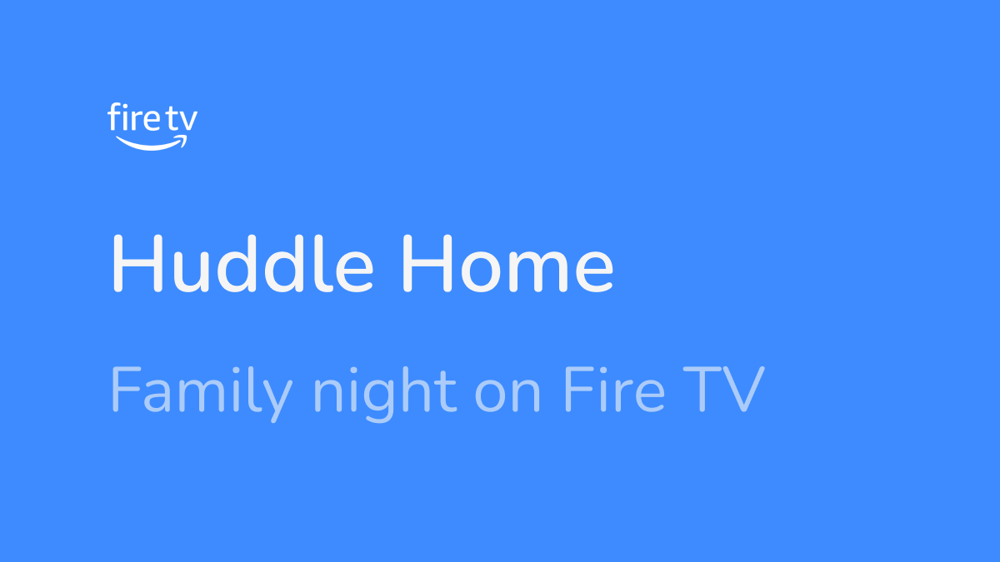
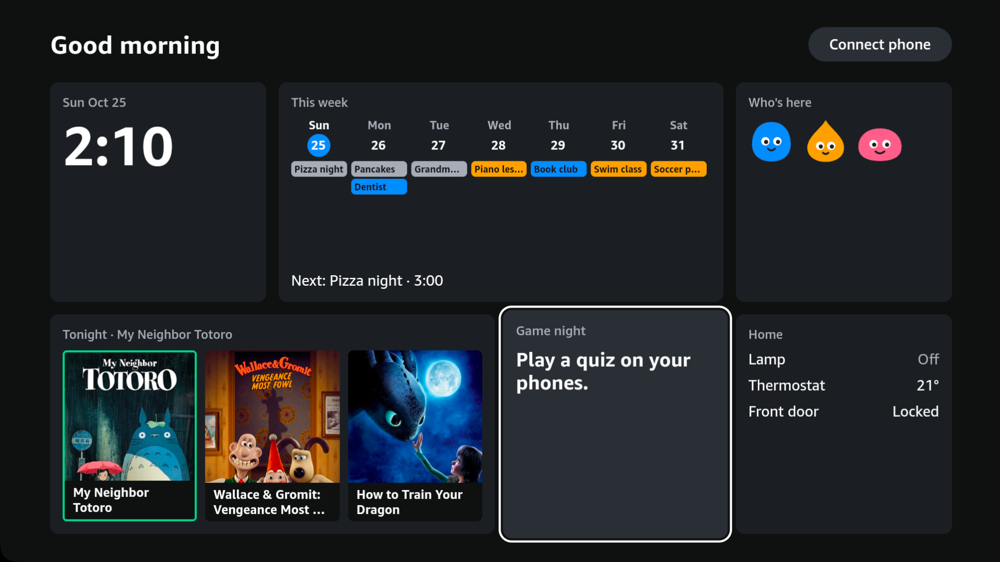
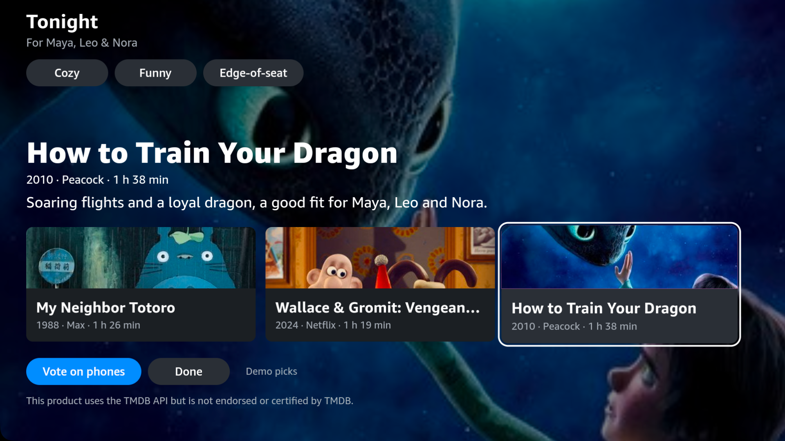
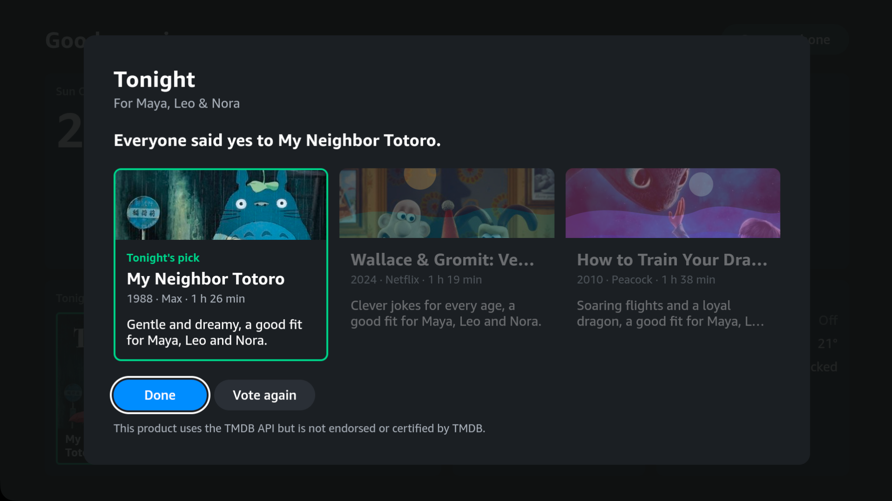
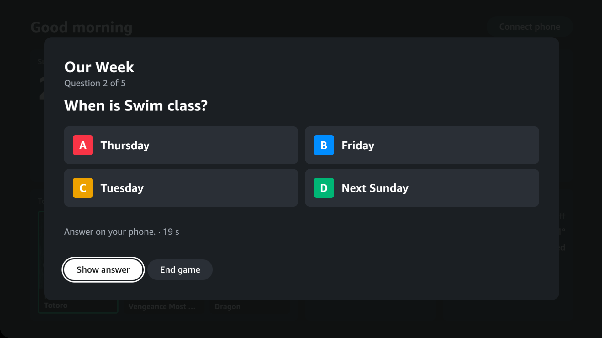
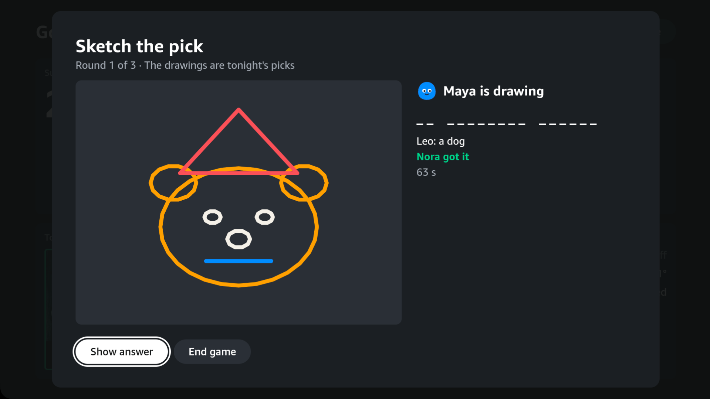
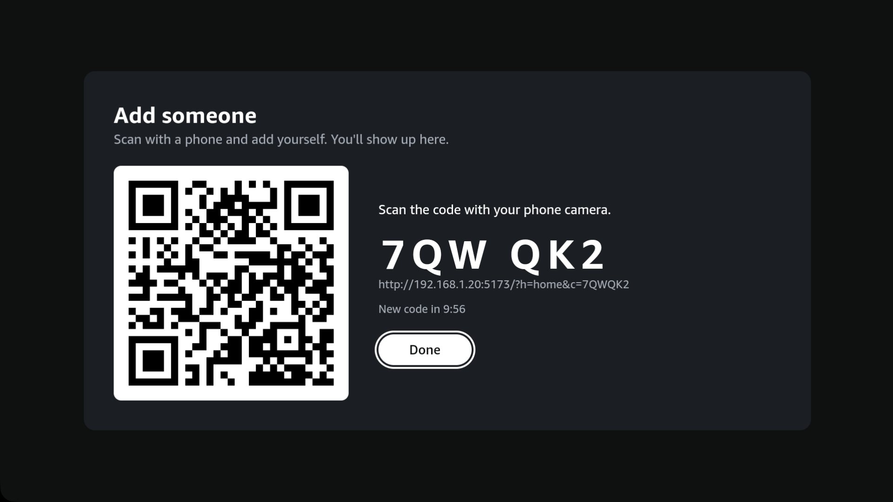
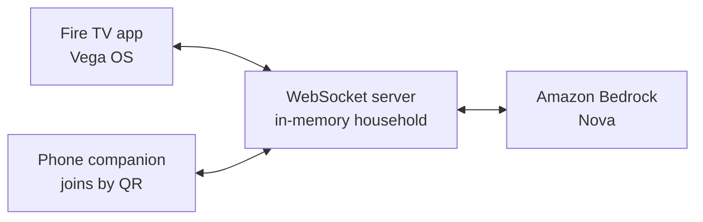

# Huddle Home


Huddle Home is a family home screen for Fire TV on Vega OS. The TV shows the household that is actually on the couch: the clock and the weather, today's calendar, who is here, and what to watch tonight. Phones join with a QR code and become the keyboard, the private ballot, and the pens. Tonight's picks come from Amazon Bedrock (Nova), finish in time for bedtime, and the family settles them with a secret vote. Game night is a quiz about your own week, plus Sketch the pick.

> Status: **work in progress.** This is the first MVP: every feature below runs end to end on the Vega Virtual Device, and the design and features are still changing.

## Screens













Stills from the Vega Virtual Device are also in [`docs/screenshots/`](docs/screenshots/).

## Features

- **Home.** Clock, weather from Open-Meteo, family calendar, who's here, Tonight, game night, and a home tile. The lamp, thermostat, lock and doorbell are simulated. The doorbell is not a Ring camera.
- **Tonight.** Three picks for the people in the room, from Amazon Bedrock Nova Lite, or a deterministic mock when Bedrock is off. Moods are Cozy, Funny and Edge-of-seat. A child's bedtime, or an early start tomorrow, drops picks that run too long. Whether a title is actually on a streaming service is not checked.
- **Posters.** With a TMDB key on the server, each pick can show a movie poster. No key, no match, or a poster that fails to load falls back to the Tonight backdrop: painted by Nova Canvas when Bedrock is on, otherwise drawn on the TV.
- **Secret vote.** Each phone says yes or no in private. The TV shows who has voted, then only the picks everyone accepted.
- **Game night.** Our Week is a quiz built from the household, with no model. Watched It is written by Nova Pro and falls back to a mock bank. Sketch the pick: one phone draws, the others guess. Scores sit in a family league that lives in memory and resets when the server restarts.
- **Phone.** Join from the QR code, pick who you are, change who's watching, message the TV, chat (Nova Micro, or the mock), vote, answer and draw.
- **Focus kit.** [`packages/tv-focus-kit`](packages/tv-focus-kit/README.md) is a small set of D-pad focus primitives for React Native TV (MIT).

Polly, Transcribe, DynamoDB, S3 and Lightsail are not used. What is real and what is simulated: [docs/product/customizing.md](docs/product/customizing.md).

## Tech stack

- React Native for Vega OS TV app
- React + Vite phone companion
- Node/TS WebSocket server
- Amazon Bedrock Nova
- npm workspaces

Open-Meteo supplies the weather and needs no key. TMDB supplies posters when `TMDB_API_KEY` or `TMDB_READ_TOKEN` is set.

## How it fits together

The TV and the phones talk only to the WebSocket server. The server calls Amazon Bedrock. Household state stays in the server process. With a TMDB key, the server also looks up a poster for each Tonight title and caches it in memory. Diagram and the protocol: [architecture](docs/architecture/architecture.md).



## Setup

**Target platform:** Vega OS. Demo on the Vega Virtual Device (included with the SDK). A Vega Fire TV Stick needs OS 1.2 for SDK 0.24. The Fire TV Stick HD (1st gen) in the house is Fire OS 8 and cannot run this app.

The SDK installer is interactive and wants about **20 GB** free. Prerequisites (Homebrew packages, Vega Studio) are already on this Mac. Run the installer yourself:

```bash
curl -fsSL https://sdk-installer.vega.labcollab.net/get_vvm.sh | bash && source ~/vega/env
vega --version
```

Docs: [Install the Vega Developer Tools](https://developer.amazon.com/docs/vega/0.24/install-vega-sdk.html). Add `@amazon-devices/*` packages with `vega project install <package>` so versions match the SDK, then `npm install`.

### Vega Fire TV (only if the stick is on Vega OS)
1. Settings → My Fire TV → About → press Select on the device name 7 times → developer mode
2. `vega devmode login` to link the device (SDK 0.24)
3. Install and run from Vega Studio, or `vega device` commands in [Run your app](https://developer.amazon.com/docs/vega/0.24/run-apps.html)

### Apps

npm workspaces monorepo. Node ≥ 20.

```bash
npm install            # all workspaces
npm run check          # typecheck every workspace + unit tests
```

**TV app on the Vega Virtual Device**

```bash
source ~/vega/env
vega virtual-device start
npm run build:tv       # apps/tv debug .vpkg (aarch64, armv7, x86_64)
npm run tv:install
npm run tv:launch
```

D-pad: the remote on the VVD window, or `vega exec vda shell "inputd-cli button_press KEY_RIGHT"`. Screenshots: `scripts/vvd-capture.sh out.png KEY_DOWN KEY_ENTER` (presses keys, then captures the VVD screen).

**Server and phone companion**

```bash
cp apps/server/.env.example apps/server/.env   # optional
npm run dev:server     # ws://<LAN IP>:8787/ws; prints the URLs it detected
npm run dev:companion  # http://<LAN IP>:5173, the page the QR code opens
```

### Keys and settings

Only one thing needs a key, and it is optional. Everything else works out of the box. Server settings go in `apps/server/.env` (copy it from [`.env.example`](apps/server/.env.example)). That file is git-ignored, so keys never get committed.

| What | Key? | How to turn it on |
|---|---|---|
| **Weather** | No key | [Open-Meteo](https://open-meteo.com/) is free and keyless. Refreshed every 15 minutes. |
| **Tonight picks, chat, quiz (AI)** | No key; AWS credentials | Mock by default. For Amazon Nova, set `HUDDLE_AI=bedrock` and sign in to AWS. |
| **Tonight backdrops** | Same AWS credentials | Painted by Nova Canvas when Bedrock is on. Otherwise the TV draws them. |
| **Movie posters** | TMDB key (free) | Set `TMDB_API_KEY` or `TMDB_READ_TOKEN`. |

**Weather.** There's nothing to sign up for. It shows Toronto unless you set a place:

| Variable | Default | What it does |
|---|---|---|
| `HUDDLE_PLACE` | `Toronto` | Name shown on the clock tile |
| `HUDDLE_LAT`, `HUDDLE_LON` | `43.65`, `-79.38` | Where to fetch the forecast for |
| `HUDDLE_WEATHER` | on | `off` stops fetching (offline demos) |

**Amazon Bedrock (AI).** Bedrock has no API key. The server uses your normal AWS credentials (`aws login`, an `AWS_PROFILE`, or `~/.aws`). In the AWS console, open Bedrock → Model access in your region and enable Nova Lite, Micro and Pro, plus Nova Canvas for backdrops. A new AWS account can start with Bedrock quotas at zero; request an increase if calls fail.

| Variable | Default | What it does |
|---|---|---|
| `HUDDLE_AI` | `mock` | `bedrock` calls Amazon Nova; `mock` needs no AWS account |
| `AWS_REGION` | `us-east-1` | Bedrock region |
| `AWS_PROFILE` | default chain | Which AWS profile to use |
| `HUDDLE_TONIGHT_MODEL` | `us.amazon.nova-lite-v1:0` | Tonight picks |
| `HUDDLE_CHAT_MODEL` | `us.amazon.nova-micro-v1:0` | Phone chat |
| `HUDDLE_QUIZ_MODEL` | `us.amazon.nova-pro-v1:0` | "Watched It" quiz questions |
| `HUDDLE_ART` | on with Bedrock | `off` skips Nova Canvas; the TV draws backdrops |
| `HUDDLE_ART_MODEL` | `amazon.nova-canvas-v1:0` | Backdrop image model |
| `HUDDLE_ART_DIR` | `apps/server/.art-cache` | Where painted backdrops are kept |

If Bedrock fails or times out, the server quietly falls back to the mock, so the TV never shows an error.

**TMDB (movie posters).** Create a free account at [themoviedb.org](https://www.themoviedb.org/signup), then go to [Settings → API](https://www.themoviedb.org/settings/api) and request a key. It asks for a short form (choose personal or educational use and describe the app in a line), and approval is usually instant. The page then shows two values. Use either one:

| Variable | Which value from the TMDB page |
|---|---|
| `TMDB_API_KEY` | **API Key**: the short one, 32 characters |
| `TMDB_READ_TOKEN` | **API Read Access Token**: the long one, starts with `eyJ` |

For each Tonight title the server calls `/search/movie`, takes `poster_path`, and sends `https://image.tmdb.org/t/p/w342/…` as `posterUrl`. Results are cached in memory. Mock and Bedrock modes both get posters. Series often have no movie match. With no key, or when a poster fails to load, the TV shows the backdrop instead.

This product uses the TMDB API but is not endorsed or certified by TMDB.

**Network and build settings** (no keys; the defaults detect your LAN IP):

| Variable | Where | What it does |
|---|---|---|
| `PORT`, `HOST` | server `.env` | Where the server listens (`8787`, `0.0.0.0`) |
| `HUDDLE_LAN_IP` | server `.env` | Override the detected LAN IP |
| `COMPANION_URL` | server `.env` | The page the QR code opens (default `http://<LAN IP>:5173/`) |
| `HUDDLE_SERVER_URL`, `HUDDLE_PORT`, `HUDDLE_HOUSEHOLD` | TV build, e.g. `HUDDLE_SERVER_URL=ws://… npm run build:tv` | Server address and household baked into the TV app |
| `VITE_HUDDLE_SERVER_URL` | `apps/companion/.env` | Server address for the phone page (default: the host it was opened from) |

**Pair a phone:** start the server and the phone app, then build and launch the TV app. On the TV press Up to reach **Connect phone**, then Select. Scan the QR with a phone on the same Wi-Fi. From the phone you can switch who's watching and send a message to the TV.

#### Networking: TV, phone and server on one LAN
Everything talks to the Mac on its **LAN IP**, never `localhost`:

| Who | Reaches the server at | Set by |
|---|---|---|
| Server | listens on `0.0.0.0:8787` | `PORT`, `HOST` |
| TV app (VVD) | `ws://<LAN IP>:8787/ws`, baked in at build time | `apps/tv/scripts/write-config.mjs` writes `src/config.generated.ts` (gitignored) before every build/test. Override: `HUDDLE_SERVER_URL=ws://… npm run build:tv` |
| QR code / join URL | `http://<LAN IP>:5173/?h=<household>&c=<code>` | server's `COMPANION_URL` (default: detected LAN IP, port 5173) |
| Phone (companion) | `ws://<host it was opened from>:8787/ws` | `?s=ws://…` in the URL, or `VITE_HUDDLE_SERVER_URL` (see `apps/companion/.env.example`) |

- **Vega Virtual Device → Mac** works on both the Mac's LAN IP and `10.0.2.2` (QEMU's alias for the host). `localhost` inside the VVD is the VVD itself. We use the LAN IP so the TV and the phone agree on one address. Checked with `vega exec vda shell "curl http://<ip>:<port>/"`.
- **Phone → Mac** needs the same Wi-Fi, and no client isolation on that network (guest and some office networks block device-to-device traffic). macOS may ask to allow incoming connections for `node`. Say yes, or check *System Settings → Network → Firewall*.
- **The LAN IP changed** (new network): rebuild the TV app (`npm run build:tv`) so it picks up the new address, and restart the server.
- **Restarting** the server forgets households, the league and the poster cache. They live in memory for the session. The TV reclaims its household automatically. Phones need to scan the QR code again.

## Repository

| Path | What |
|---|---|
| `apps/tv` | Fire TV app (React Native for Vega OS; demo on the Vega Virtual Device) |
| `apps/companion` | Phone companion (React + Vite web app, opened via QR) |
| `apps/server` | API + realtime (Node + TS, WebSocket, Amazon Bedrock). Household and league state are in memory |
| `packages/shared` | Shared types + theme tokens |
| `packages/tv-focus-kit` | D-pad focus primitives (MIT) |
| `docs/` | PRD, architecture, design, research, screenshots |
| `reference/` | Amazon sample apps (gitignored): `./scripts/fetch-references.sh` |

Docs index: [`docs/README.md`](docs/README.md).

### Dev tooling
- **Amazon Devices Builder Tools** (MCP + Agent Skills) is configured for Claude Code. Context: `.claude/amazon-devices/CLAUDE.md`; platform: `.adbt-config.json`. Check with:
  `npx -y @amazon-devices/amazon-devices-buildertools-mcp@latest check-status --agent claude-code-cli`
- Update it with:
  `npx -y @amazon-devices/amazon-devices-buildertools-mcp@latest init-context --agent claude-code-cli -p .claude/amazon-devices -m --force`
