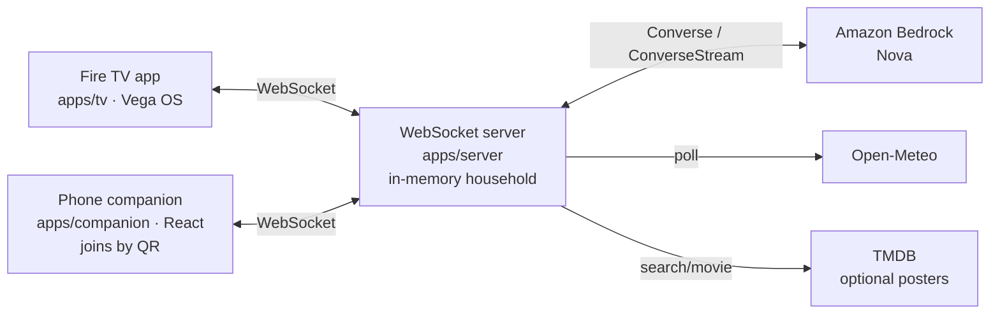

# Architecture

## 1. Overview

What runs today. The TV and the phones talk only to the WebSocket server. The server calls Amazon Bedrock. With `TMDB_API_KEY` or `TMDB_READ_TOKEN`, it also looks up a poster for each Tonight title (`/search/movie`) and caches the image URL in memory. No key, no match, or a failed lookup leaves the title card. Household state (profiles, calendar, messages, devices, tonight, votes, games, the league) lives in the server process. A restart clears it, including the poster cache.



```
  Fire TV (apps/tv, Vega)  <---- WebSocket ---->  Huddle server (apps/server)
  Phone (apps/companion)   <---- WebSocket ---->       |
        ^                                              | in-memory household
        | QR join URL                                  | and league
        +----------------------------------------------+
                                                       |
                         +-----------------------------+
                         |                             |
                         v                             v
              Amazon Bedrock (Nova)           TMDB (optional posters)
              Tonight, chat, Watched It       /search/movie, cached
```

Not used: DynamoDB, S3, Lightsail, Polly, Transcribe. Polly and Transcribe stay stretch. There is no hosted box.

**The hub.** One household on the server. Clients join with a role:
- **`tv`**: the Fire TV app (Vega, `apps/tv`). It is the main screen.
- **`phone`**: the companion web app, opened from the QR code. It is the keyboard, the chat box, the private ballot (secret veto) and the Sketch the pick pen.
- **`display`** (later): a second screen that mostly reads, such as an Echo Show via an Alexa skill that opens our web page. See [echo-show.md](../research/echo-show.md).
- **`voice`** (stretch): an Alexa skill backend.

**Principles**
- The **server is the source of truth**. The TV and the phones are views. An Alexa `voice` client is stretch and not built.
- Before the first `welcome`, the TV shows a local profile list. It does not persist the household. A server restart clears it.
- AI calls are not on the path of painting Home. Tonight shows "Getting picks…" while a request is out.

## 2. Repo layout

npm workspaces. `npm run check` typechecks every workspace and runs all unit tests. Workspace packages ship TypeScript source (`main: src/index.ts`): Metro (TV), Vite (companion) and tsx (server) compile them directly, so there's no build step.

| Path | Stack | Purpose |
|---|---|---|
| `apps/tv` | React Native for Vega (SDK 0.24, RN 0.72) | TV app |
| `apps/companion` | React + Vite + TS | Phone web app |
| `apps/server` | Node + TS (Fastify + `ws`) | API, realtime, AI orchestration |
| `packages/shared` | TS | Types (events, models), theme tokens |
| `packages/tv-focus-kit` | TS / RN | Candidate open-source package |

## 3. TV app

- **Base:** the Vega app in `react-native-multi-tv-app-sample`. Its web target is handy for fast design iteration in a browser. Stay on that sample's React Native version (0.72 until its 0.83 migration lands). SDK 0.24 can scaffold a new app on React Native 0.83, and several Expo libraries are not stabilized there yet.
- **Navigation:** Amazon's react-navigation packages (skill: `amazon-devices-vega-navigation`)
- **Focus:** `@huddle/tv-focus-kit`. `FocusGrid` computes each neighbour in plain TS (`grid.ts`, unit tested) and sets `nextFocus*` on Vega's `Pressable`. Edges fall back to native Cartesian focus. Grids sit inside `TVFocusGuideView autoFocus` so focus coming back from outside lands on the last cell. Verified on the VVD in step 1.
- **Widgets:** there is no shared `Widget` type. Home is a `FocusGrid` of six tiles (`clock`, `calendar`, `profiles`, `tonight`, `game`, `smart-home`), each a `FocusGridItem` plus `WidgetTile`. Select opens a sheet for Tonight, Game night and Home. Clock and calendar are focusable and do not open a sheet. States: [screen-inventory.md](../design/screen-inventory.md).

## 4. App launching

**Not built.** Demoted Oct 17. The TV app does not call `Linking`. The notes below are the spike that was never run.

**The TV app targets Vega OS.** Vega has no Android `PackageManager`, so Huddle does not scan the device for installed apps. The phone companion stores which services the household has. The TV opens them with React Native `Linking`:

```ts
const supported = await Linking.canOpenURL(url);
if (supported) await Linking.openURL(url);
```

URI shapes Vega accepts ([deep links](https://developer.amazon.com/docs/vega/0.22/deep-links-vega-apps.html), [Linking](https://developer.amazon.com/docs/react-native-vega/0.72/linking.html)):

| Kind | Example | Use |
|---|---|---|
| Custom scheme | `netflix://…` | Open an app, or a title when that app publishes a scheme |
| https | `https://www.netflix.com/title/…` | Title pages some apps claim |
| App identifier | `amzns://apps?asin=B00…` | Open an Appstore app by ASIN |
| Appstore fallback | same `amzns://` form | App missing → its store page |

`@amazon-devices/kepler-media-content-launcher` is the API a media app implements so Fire TV can launch *into that app*. Huddle is the caller, so `Linking` is the path. Use Content Launcher only if the Day-1 spike shows a title handoff requires it.

**Spike results (fill in on Day 1):**

| App | Open app | Open specific title | URI used | Works on VVD? |
|---|---|---|---|---|
| Netflix | | | | |
| Prime Video | | | | |
| YouTube | | | | |
| Disney+ | | | | |
| Crave | | | | |
| Spotify | | | | |

Launch flow: `canOpenURL(titleUri)` → open title; else `canOpenURL(appUri)` → open app; else show "Not installed: get it from the Appstore". Log every launch (`profileIds`, `appId`, `hour`, `weekday`) to the server.

## 5. Server

- **Realtime:** one WebSocket channel per household; events below.
- **Storage:** in memory, one household object per id (`apps/server/src/household.ts`, held by `hub.ts`). The snapshot is profiles, who's here, calendar, messages, simulated devices, weather, Tonight (including the vote), the game, the Sketch canvas and the league. DynamoDB and S3 are not used. A restart wipes the household and the league. The TV reclaims its household on the next `hello`. Phones scan the QR again. The league is **within a session**: it totals finished games until the process stops, and it does not carry across nights.
- **Pairing (step 2, built):**
  1. The TV says `hello` as `tv` for its household (`HOUSEHOLD_ID`, default `home`). The **first TV claims the household** and gets a TV token in `welcome`, which it keeps in AsyncStorage. After that, only a TV holding that token may connect as `tv` (`tv-claimed` otherwise). A reconnecting TV replaces its old socket.
  2. "Connect phone" → `pair:request` → `pair:code {code, expiresAt, joinUrl}`. Codes are 6 characters from an unambiguous alphabet, live 10 minutes and can be reused within that window. The TV asks for a new one 30 s before expiry. `joinUrl` = `COMPANION_URL?h=<householdId>&c=<code>`, and that's what the QR encodes.
  3. A phone or display must send a valid, unexpired `pairCode` in `hello` (`pairing-required` / `pair-code-invalid` / `pair-code-expired` otherwise, then the socket closes). Its `welcome` carries a session token, so reconnects work after the code expires.
  4. Every inbound payload is shape-checked (`packages/shared/src/validate.ts`) before a handler runs. Bad frames get an `error` reply with `replyTo`. Each frame is handled inside a try/catch, so one bad frame can't crash the process. Frames over 16 KB are refused.
- No accounts: the household code + tokens are the whole auth model for the hackathon.

### Realtime protocol
Source of truth: [`packages/shared/src/protocol.ts`](../../packages/shared/src/protocol.ts) (types + routing tables, unit tested).

- Envelope: `{v: 1, id, ts, type, payload}`. `parseEnvelope` rejects anything else.
- Handshake: client → `hello {householdId, client: {clientId, role, label?, profileId?}, capabilities, topics, pairCode?}`. Server → `welcome {snapshot, you}`.
- Routing: each server message belongs to a topic (`SERVER_MESSAGE_TOPIC`). A client only gets the topics it subscribed to. `DEFAULT_TOPICS` per role.
- Permissions: `CLIENT_MESSAGE_ROLES`. The server answers anything else with `error {code: 'forbidden'}`.

| Client → server | Who | Server → clients | Topic |
|---|---|---|---|
| `profile:switch` | tv, phone, voice | `profile:changed` | household |
| `message:send` | phone, voice | `message:new` | messages |
| `chat:ask {text, conversationId?}` | phone, voice, tv | `chat:reply` chunks then `done`, to the asker only | chat |
| `tonight:request {mood?}` | tv, phone, voice | `tonight:picks {picks, mood?, forProfileIds, at, source, endsBy?, chosen?}` to everyone; also in the snapshot. `endsBy` = a kid's bedtime or an early start tomorrow (server local time); picks that run past it are dropped | tonight |
| `tonight:vote-start` / `tonight:vote {voteId, yes[]}` / `tonight:vote-next` / `tonight:vote-end` | tv+phone / phone / tv+phone / tv+phone | `tonight:vote-state` (`voting → [sudden-death] → result`; only *who* voted, never ballots; the result has the picks everyone accepted and the winner, which also sets `tonight.chosen`) | tonight |
| `sketch:stroke {gameId, round, stroke}` (same stroke id appends) / `sketch:clear` / `sketch:guess {text}` | drawer's phone / drawer's phone / other phones | `sketch:prompt` (title, to the drawer's phones only), `sketch:stroke`, `sketch:clear`, `sketch:guess` (no text when right); the current drawing is in the snapshot | sketch |
| `game:start {kind: 'quiz', source: 'our-week' \| 'watched-it', title?} \| {kind: 'sketch'}` / `game:answer {gameId, round, choice, profileId?}` / `game:next` / `game:end` | tv+phone / phone / tv+phone / tv+phone | `game:state` (phases `loading → question ⇄ reveal → final`; the right answer only in `reveal`; in Sketch the pick a question is one drawing round with `drawerId` and `hint`, and the last title drawn becomes `tonight.chosen`), `league:updated` after a finished game; both in the snapshot | game |
| `door:simulate {kind?}` | phone | `door:event` | door |
| `smart-home:set` | tv, phone, voice | `smart-home:state` | smart-home |
| `calendar:add` / `calendar:remove` | phone, voice | `calendar:updated` (whole sorted list) | calendar |
| — (server polls Open-Meteo every 15 min) | | `weather:updated` | weather |
| `pair:request` | tv | `pair:code` (to that TV only) | — |
| `subscribe`, `ping` | all | `pong`, `error`, `client:joined/left` | — / household |

## 6. AI features (Bedrock)

The hub talks to a `HouseholdAI` interface (`apps/server/src/ai/`). `BedrockAI` calls Nova through the Converse API. `MockAI` is deterministic and uses no AWS. `HUDDLE_AI=bedrock` turns Bedrock on. The mock is the default and the per-request fallback, so a Bedrock error or timeout never shows on the TV. Verified Oct 18 in us-east-1: Tonight ~1.1 s, chat ~0.5 s, quiz ~2.7 s, all `source: bedrock`. Claude models on Bedrock are not available on this account.

| Feature | Model | What the code does |
|---|---|---|
| **Tonight picks** | `us.amazon.nova-lite-v1:0` (Converse) | Three picks (title, year, why, service, minutes) for the people present and a mood. JSON is parsed and clipped by hand. Picks that run past the bedtime limit are dropped and topped up from the mock. Broadcast on `tonight` and kept in the snapshot |
| **Phone chat** | `us.amazon.nova-micro-v1:0` (ConverseStream) | Streamed to the asking phone only. The prompt has who's here, the calendar, the weather and the devices. Tonight times out at 10 s, chat at 25 s, the quiz at 12 s |
| **Watched It** | `us.amazon.nova-pro-v1:0` | Asks for 8 questions, then a second cold pass keeps only the ones both passes agree on. Fewer than 3 usable questions → the mock bank. *Our Week* does not call a model: questions come from the calendar, messages, weather and devices |

Not built: a daily brief, natural-language calendar entry, launch-pattern phrases, a watch-provider check (no TMDB call), and a Strands agent. The model is not trusted for "it's on Netflix"; the pick card shows the service the model named, with no availability lookup.

### Voice
Polly and Transcribe are **not used**. The server does not synthesize speech, and the phone has no hold-to-talk. Both stay stretch.

## 7. External data
| Need | What the code does |
|---|---|
| Weather | Open-Meteo, no key. The server polls every 15 min (`apps/server/src/weather.ts`) |
| Titles and where to watch | Not called. No TMDB |
| Sports scores | Not called |

## 8. Where it runs
- Dev and the current demo: the Node server and the Vite companion on the same machine as the Vega Virtual Device, on the LAN. See the README › Networking. The TV's server URL is baked in at build time.
- No Lightsail, EC2 or other host is set up. The companion is not served by the API process.
- Secrets in `.env` (gitignored); `.env.example` committed. $250 AWS credits are active (Oct 18). Spend so far is Bedrock only.

## 9. Open questions
- ~~Vega or Fire OS?~~ **Vega OS** (Oct 7). Demo on the Vega Virtual Device. The Stick HD on Fire OS 8 cannot run this build.
- ~~Echo app?~~ **No Vega app.** Echo devices run Vega, but there's no third-party app path. An Echo Show can join later as a `display` client through an Alexa skill + `Alexa.Presentation.HTML` ([echo-show.md](../research/echo-show.md)).
- Which streaming apps support title-level deep links on this device? (spike)
- Can `react-native-multi-tv-app-sample`'s web target share the same focus code? (matters for fast design iteration)
